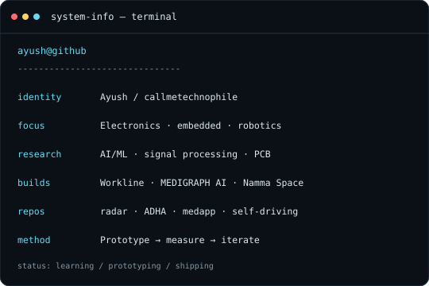

### `ayush@github:~$ ./contributions --year rolling`

<table>
<tr>
<td valign="top" width="42%">

</td>
<td valign="top" width="58%">

</td>
</tr>
</table>

`ayush@github:~$` <a href="https://github.com/callmetechnophile?tab=repositories">ls ./repositories</a> · <a href="https://github.com/callmetechnophile/workline">workline</a> · <a href="https://github.com/callmetechnophile/medapp">medapp</a> · <a href="https://github.com/callmetechnophile/ADHA">ADHA</a> · <a href="https://github.com/callmetechnophile/radar">radar</a>

<!-- Assets are generated by scripts/generate_profile_art.py. The contribution graph uses public GitHub profile data. -->
